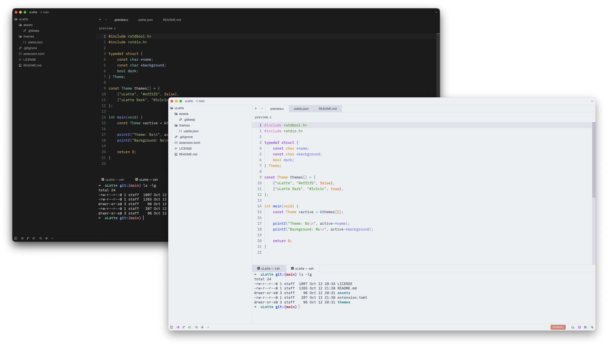

# uLatte

A theme family for [Zed](https://zed.dev), with unified backgrounds for a
seamless interface: a light variant based on
[Catppuccin Latte](https://github.com/catppuccin/zed) and a dark variant with
neutral charcoal surfaces and a custom syntax palette.

The editor, panels, title bar, and status bar share the same background color,
giving the workspace a consistent look, with color reserved for code and
interactive elements.

<!-- Add a screenshot of the theme in Zed at assets/preview.png, then uncomment:

-->

## Installation

### Development extension

1. Download or clone this repository.
2. Open the command palette in Zed and run `zed: install dev extension`.
3. Select the repository root (the directory containing `extension.toml`).
4. Run `theme selector: toggle` and select **uLatte** or **uLatte Dark**.

## Credits and license

The light variant is based on [Catppuccin for Zed](https://github.com/catppuccin/zed),
specifically Latte. The dark variant started from Mocha and now uses a custom
neutral palette. uLatte is an independent customization and is not an official
Catppuccin theme.

Distributed under the [MIT License](LICENSE), with the original Catppuccin
copyright notice preserved.
